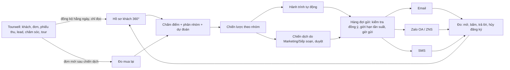
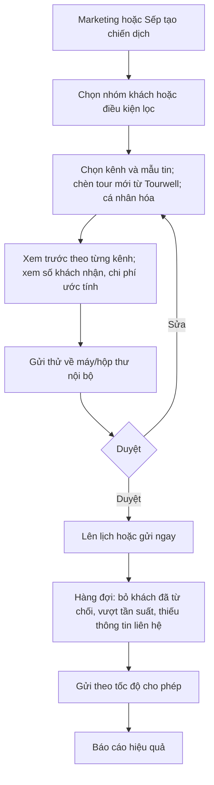
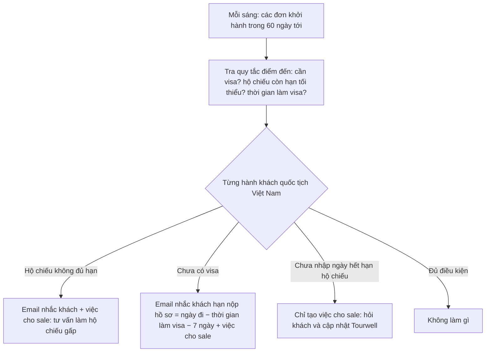

# Đặc tả yêu cầu phần mềm (SRS) – Hệ thống chăm sóc khách hàng AdenZ (AdenZ Care)

| Mục                 | Nội dung                                                                                                                                                                              |
| ------------------- | ------------------------------------------------------------------------------------------------------------------------------------------------------------------------------------- |
| Dự án               | AdenZ Care: chăm sóc khách đã mua và đã tương tác, gửi tour mới, thông tin, hỗ trợ đa kênh (Email, Zalo, SMS); chấm điểm khách tiềm năng và dự đoán để áp dụng chiến lược, chính sách |
| Doanh nghiệp        | AdenZ Travel (A to Z Travel), 18-20 Hoa Trà, Phường 7, Phú Nhuận, TP.HCM                                                                                                              |
| Phiên bản           | 0.3 (bản trình duyệt – giai đoạn Email, đã có Quy trình chăm sóc v1)                                                                                                                  |
| Ngày                | 29/10/2026                                                                                                                                                                            |
| Trạng thái          | Chờ Ban giám đốc duyệt bản demo Email; Zalo ZNS, SMS làm sau khi được duyệt và cấp quyền OA                                                                                           |
| Thay thế            | SRS Thông báo Tourwell v0.1 (bỏ phần thông báo nội bộ theo yêu cầu ngày 26/10/2026)                                                                                                   |
| Nguồn dữ liệu       | Tourwell CRM (khảo sát API thật ngày 21/10/2026)                                                                                                                                      |
| Ràng buộc ngân sách | Tự xây dựng; giai đoạn 1 chỉ dùng email (0đ); kênh có phí (Zalo ZNS, SMS) chỉ bật khi Ban giám đốc duyệt ngân sách                                                                    |
| Bản demo            | `npm run care` → http://localhost:3030 (dữ liệu mẫu hư cấu; xem mục 18)                                                                                                               |

**Quy ước:** ✅ đã có (bản thử nghiệm) · 🔧 đang làm · 📅 kế hoạch. Ưu tiên M = bắt buộc · S = nên có · C = có thì tốt. **[CẦN KIỂM]**: chưa xác nhận, phải kiểm trước khi làm.

---

## 1. Ngữ cảnh nghiệp vụ

### 1.1 Vấn đề

| Mã   | Vấn đề                                                                                                  | Hậu quả                                                  |
| ---- | ------------------------------------------------------------------------------------------------------- | -------------------------------------------------------- |
| BP01 | Sau khi khách đi tour về, công ty **không liên lạc lại** một cách có hệ thống.                          | Khách quên AdenZ, lần sau mua ở công ty khác.            |
| BP02 | Khách đã hỏi tour (lead) nhưng chưa mua **không được nuôi dưỡng** tiếp.                                 | Mất khách tiềm năng đã tốn tiền quảng cáo để có.         |
| BP03 | Không biết **khách nào đáng ưu tiên**: ai sắp mua, ai có nguy cơ rời bỏ, ai là khách VIP.               | Sale gọi dàn trải; ưu đãi gửi nhầm người.                |
| BP04 | Tour mới, chương trình ưu đãi **không đến đúng khách quan tâm** (đã đi Nhật thì gửi tour Nhật lần nữa). | Khách thấy phiền, tỷ lệ phản hồi thấp.                   |
| BP05 | Gửi tin thủ công qua Zalo cá nhân, email lẻ tẻ; **không đo được hiệu quả**.                             | Không biết chiến dịch nào ra đơn.                        |
| BP06 | Không quản lý việc khách **đồng ý / từ chối** nhận tin.                                                 | Rủi ro vi phạm quy định chống tin rác, mất uy tín.       |
| BP07 | Khách đến sát ngày đi mới phát hiện **hộ chiếu không đủ hạn hoặc chưa có visa**.                        | Mất chuyến, hoàn tiền, mất uy tín.                       |
| BP08 | Không ai nhắc khách khi **hộ chiếu sắp hết hạn** dù AdenZ có dịch vụ làm hộ chiếu, visa.                | Bỏ lỡ doanh thu dịch vụ, khách tự làm hoặc làm nơi khác. |

### 1.2 Mục tiêu nghiệp vụ

| Mã         | Mục tiêu                                                                                                     |
| ---------- | ------------------------------------------------------------------------------------------------------------ |
| **BG01** ★ | **Tăng khách mua lại**: mỗi khách đã mua được chăm sóc và nhận đúng tour, ưu đãi phù hợp.                    |
| BG02       | Chuyển lead đã tương tác thành khách mua bằng nuôi dưỡng tự động.                                            |
| BG03       | Biết khách nào tiềm năng (chấm điểm, dự đoán) để áp dụng chiến lược và chính sách phù hợp.                   |
| BG04       | Marketing và Sếp tự soạn, duyệt, gửi chiến dịch đa kênh (Email, Zalo, SMS) không cần kỹ thuật.               |
| BG05       | Đo được hiệu quả: gửi, mở, bấm, phản hồi, đơn mua lại theo từng chiến dịch.                                  |
| BG06       | Tuân thủ quy định về tin quảng cáo và dữ liệu cá nhân; chi phí vận hành thấp.                                |
| BG07       | Không để khách lỡ chuyến vì giấy tờ: kiểm tra hộ chiếu, visa trước mỗi chuyến đi theo quy tắc từng điểm đến. |
| BG08       | Chăm sóc theo chu kỳ dịch vụ: hộ chiếu sắp hết hạn, kỷ niệm chuyến đi, gợi ý chuyến tiếp theo.               |

### 1.3 Người sử dụng

| Người dùng              | Làm gì                                                                                                                                 |
| ----------------------- | -------------------------------------------------------------------------------------------------------------------------------------- |
| **Ban giám đốc (Sếp)**  | Soạn, duyệt, gửi chiến dịch; xem phân nhóm, điểm tiềm năng, hiệu quả; đặt chính sách (ưu đãi theo nhóm, giới hạn tần suất)             |
| **Marketing**           | Soạn, duyệt, gửi chiến dịch; quản lý mẫu tin, nhóm khách; xem báo cáo                                                                  |
| **Sale**                | Xem trang **Việc cần làm**: khách nóng cần gọi, giấy tờ chuyến sắp đi có vấn đề, khách cần làm hộ chiếu mới; bấm "Xong" khi xử lý xong |
| **Bộ phận visa**        | Cập nhật **quy tắc giấy tờ theo điểm đến** (cần visa, hộ chiếu còn hạn tối thiểu, thời gian làm visa)                                  |
| **Quản trị (kỹ thuật)** | Kết nối Tourwell, kênh gửi, tài khoản; theo dõi lỗi                                                                                    |
| **Khách hàng**          | Nhận tin; bấm xem tour; trả lời; **từ chối nhận tin**                                                                                  |

---

## 2. Bên liên quan

| Mã   | Bên liên quan                              | Quan tâm                                             | Ảnh hưởng  |
| ---- | ------------------------------------------ | ---------------------------------------------------- | ---------- |
| SH01 | Ban giám đốc                               | Doanh thu khách cũ, chi phí, uy tín                  | Cao        |
| SH02 | Marketing                                  | Công cụ soạn, gửi, đo chiến dịch                     | Cao        |
| SH03 | Sale                                       | Danh sách khách nóng, không bị giành khách           | Trung bình |
| SH04 | Khách hàng                                 | Tin đúng nhu cầu, không bị làm phiền, bảo vệ dữ liệu | Cao        |
| SH05 | Tourwell                                   | API đọc dữ liệu                                      | Cao        |
| SH06 | Zalo (VNG)                                 | Chính sách OA, ZNS, mẫu tin, phí                     | Cao        |
| SH07 | Nhà cung cấp SMS brandname                 | Đăng ký thương hiệu, mẫu tin, phí                    | Trung bình |
| SH08 | Nhà cung cấp hosting (PA Vietnam / cPanel) | Hạ tầng, giới hạn gửi email                          | Trung bình |

---

## 3. Phạm vi

### 3.1 Trong phạm vi

| Mã   | Hạng mục                                                                                                                                                             | Đợt                                         |
| ---- | -------------------------------------------------------------------------------------------------------------------------------------------------------------------- | ------------------------------------------- |
| SC01 | Đồng bộ dữ liệu khách, đơn hàng, phiếu thu, lead, lịch sử chăm sóc, sản phẩm/tour từ Tourwell (chỉ đọc)                                                              | Đ1                                          |
| SC02 | **Hồ sơ khách 360°**: thông tin liên hệ, lịch sử mua, điểm đến đã đi, tương tác, điểm, nhóm, trạng thái đồng ý nhận tin                                              | Đ1                                          |
| SC03 | **Chấm điểm và phân nhóm** khách đã mua (RFM) và khách tiềm năng (điểm tương tác)                                                                                    | Đ1                                          |
| SC04 | **Dự đoán**: khả năng mua, điểm đến tiếp theo, thời điểm hay đi, nguy cơ rời bỏ                                                                                      | Đ1 (quy tắc) · Đ3 (hiệu chỉnh theo dữ liệu) |
| SC05 | **Chiến lược và chính sách** theo nhóm: kịch bản chăm sóc, ưu đãi, tần suất, kênh                                                                                    | Đ1                                          |
| SC06 | **Chiến dịch**: soạn mẫu, chèn tour mới từ Tourwell, chọn nhóm, xem trước, duyệt, lên lịch, gửi                                                                      | Đ1 (Email) · Đ2 (Zalo, SMS)                 |
| SC07 | **Hành trình tự động**: xác nhận thanh toán, nhắc thanh toán, nhắc chuẩn bị, cảm ơn, gợi ý tour sau chuyến đi, khách lâu không quay lại, lead chưa mua, dịp đặc biệt | Đ1 (Email) · Đ2 (đa kênh)                   |
| SC08 | **Đồng ý / từ chối nhận tin** theo từng kênh; link hủy đăng ký                                                                                                       | Đ1                                          |
| SC09 | **Đo hiệu quả**: gửi, mở, bấm, hủy đăng ký, đơn mua lại                                                                                                              | Đ1 (Email) · Đ2                             |
| SC10 | **Việc cần làm cho Sale**: khách nóng cần gọi, giấy tờ có vấn đề, khách cần làm hộ chiếu                                                                             | Đ1                                          |
| SC11 | **Kiểm tra giấy tờ trước chuyến đi** theo bảng quy tắc từng điểm đến                                                                                                 | Đ1                                          |
| SC12 | **Chăm sóc theo chu kỳ dịch vụ**: hộ chiếu sắp hết hạn, kỷ niệm 1 năm chuyến đi                                                                                      | Đ1                                          |

### 3.2 Ngoài phạm vi

| Hạng mục                                                            | Lý do                                                           |
| ------------------------------------------------------------------- | --------------------------------------------------------------- |
| Thông báo nội bộ (email tổng hợp cho Sếp, Kế toán, Sale, Điều hành) | Bỏ theo yêu cầu ngày 26/10/2026                                 |
| Hộp thư chat Facebook/Zalo                                          | Ban giám đốc dùng Pancake                                       |
| Ghi, sửa dữ liệu trên Tourwell                                      | Chỉ đọc; khách mua vẫn tạo đơn trên Tourwell                    |
| Chạy quảng cáo Facebook/Google                                      | Ngoài phạm vi; hệ thống chỉ chăm sóc khách đã có trong Tourwell |

---

## 4. Yêu cầu nghiệp vụ

| Mã   | Yêu cầu                                                                                                                                                | Mục tiêu   |
| ---- | ------------------------------------------------------------------------------------------------------------------------------------------------------ | ---------- |
| BR01 | Mọi khách đã mua hoặc đã tương tác trên Tourwell có hồ sơ trên hệ thống, cập nhật tự động.                                                             | BG01, BG02 |
| BR02 | Mỗi khách có điểm tiềm năng và thuộc một nhóm; nhóm và điểm cập nhật hằng ngày.                                                                        | BG03       |
| BR03 | Mỗi nhóm khách gắn một chiến lược (kịch bản, ưu đãi, kênh, tần suất) do Sếp/Marketing đặt.                                                             | BG03       |
| BR04 | Marketing và Sếp tự soạn và duyệt chiến dịch; mọi chiến dịch phải được duyệt trước khi gửi.                                                            | BG04       |
| BR05 | Gửi đa kênh theo thông tin khách có: email, Zalo, SMS; chọn kênh theo loại tin và chi phí.                                                             | BG04, BG06 |
| BR06 | Không gửi tin quảng cáo cho khách đã từ chối; mỗi tin quảng cáo có cách từ chối nhận.                                                                  | BG06       |
| BR07 | Giới hạn số tin mỗi khách nhận trong tuần; không gửi giờ khuya.                                                                                        | BG06       |
| BR08 | Đo được hiệu quả từng chiến dịch đến tận đơn mua lại.                                                                                                  | BG05       |
| BR09 | Hệ thống không thay đổi dữ liệu Tourwell.                                                                                                              | Tất cả     |
| BR10 | Mọi chuyến đi sắp khởi hành được kiểm tra hộ chiếu, visa theo quy tắc điểm đến do bộ phận visa quản lý; có vấn đề thì báo khách và giao việc cho sale. | BG07       |
| BR11 | Khách được nhắc khi hộ chiếu sắp hết hạn và vào các mốc chu kỳ (kỷ niệm chuyến đi, sau chuyến đi).                                                     | BG08       |

---

## 5. Quy trình nghiệp vụ

### 5.1 Tổng thể

### 5.2 Soạn và gửi chiến dịch

### 5.3 Chấm điểm hằng ngày

1. Mỗi đêm (ví dụ 2:00), đồng bộ dữ liệu mới từ Tourwell.
2. Tính điểm RFM cho khách đã mua, điểm tương tác cho khách chưa mua (mục 7).
3. Gán nhóm; ghi lại thay đổi nhóm (ví dụ "Ấm → Nóng").
4. Kích hoạt hành trình tự động theo nhóm mới (ví dụ vừa thành "Có nguy cơ rời bỏ" → kịch bản giữ chân).
5. Khách vừa thành "Nóng" → tạo việc "Gọi khách tiềm năng nóng" cho sale phụ trách.

### 5.4 Kiểm tra giấy tờ trước chuyến đi

---

## 6. Dữ liệu nguồn từ Tourwell [ĐÃ KIỂM 21/10/2026]

| Dữ liệu                            | API (chỉ đọc)                                    | Dùng cho                                                                                                                         |
| ---------------------------------- | ------------------------------------------------ | -------------------------------------------------------------------------------------------------------------------------------- |
| Khách hàng (218)                   | `/customers`, `/customers/{id}`                  | Tên, email (`email.primary`), SĐT, nhóm (cá nhân / doanh nghiệp / đại lý), trạng thái (Đã mua / Tiếp cận), nguồn, sale phụ trách |
| Điểm đến đã đi                     | `/customers/{id}/destinations`                   | Sở thích, gợi ý tour tiếp theo                                                                                                   |
| Lịch sử đơn                        | `/orders`, `/customers/{id}/orders/history`      | Số lần mua, tổng chi, ngày khởi hành / kết thúc, trạng thái thanh toán                                                           |
| Phiếu thu                          | `/billings/receipts`                             | Xác nhận thanh toán                                                                                                              |
| Lead (139)                         | `/leads`                                         | Khách đã tương tác chưa mua: trạng thái, nguồn, dịch vụ quan tâm                                                                 |
| Báo giá                            | `/lead-quotes`                                   | Mức độ quan tâm (đã báo giá = nóng hơn)                                                                                          |
| Lịch sử chăm sóc                   | `/customer-activities`                           | Lần tương tác gần nhất, lịch hẹn                                                                                                 |
| Tour / sản phẩm (53)               | `/products`, `/products/{id}`                    | Nội dung tour mới đưa vào chiến dịch: tên, giá, số ngày, ảnh, thị trường                                                         |
| Hạng thành viên, nhóm khách, nguồn | `/membership-tiers`, `/guest-groups`, `/sources` | Phân nhóm, chính sách                                                                                                            |
| Hành khách của đơn                 | `/orders/{id}/passengers`                        | Ngày hết hạn hộ chiếu (`passport_exp_at`), quốc tịch, đã có visa (`has_visa`), trưởng đoàn: kiểm tra giấy tờ, nhắc hộ chiếu      |

**Đã xác nhận (29/10/2026):** tài liệu API Tourwell không có chức năng tự động chăm sóc theo thời gian, nên AdenZ Care đảm nhận phần này. Tourwell có mục cấu hình Zalo ZNS (`/zns-app/get`): cần hỏi admin Tourwell đang gửi ZNS gì cho khách để tránh trùng (OI08).

**[CẦN KIỂM]** trên dữ liệu thật: ngày sinh khách có trong hồ sơ không (cho kịch bản sinh nhật); điểm đến trả về dạng gì; ảnh tour có đường dẫn công khai để chèn vào email không.

---

### 6.1 Kiểm tra trên dữ liệu thật (29/10/2026, lệnh `npm run care:check`, chỉ in thống kê)

| Hạng mục       | Kết quả                                                                                                                       | Ảnh hưởng, đã xử lý                                                                                                                          |
| -------------- | ----------------------------------------------------------------------------------------------------------------------------- | -------------------------------------------------------------------------------------------------------------------------------------------- |
| Định dạng ngày | Ngày khởi hành, ngày về, ngày sinh dạng `15/12/2026`; ngày duyệt phiếu dạng `11:00 15/10/2026`                                | Đã chuẩn hóa khi đồng bộ (trước đó các mốc ngày không đọc được)                                                                              |
| Loại đơn       | Phần lớn là **dịch vụ lẻ**: vé máy bay 37, land tour 23, tour trọn gói 20, visa 17, khách sạn 11…                             | Điểm đến đọc từ tên tour, tên và mô tả dịch vụ, mã sân bay; lưu loại dịch vụ của đơn. Đơn chưa nhận ra điểm đến giảm từ 100/113 xuống 20/113 |
| Giá tour       | Ở `pricing.sale_price` / `original_price`; chỉ **7/57** tour có giá                                                           | Email hiện giá khi có; đề nghị nhập giá tour trên Tourwell                                                                                   |
| Khách hàng     | 222 khách; **email 44%**, SĐT hợp lệ 86%, ngày sinh 13%                                                                       | Email chỉ tới được chưa nửa số khách → kênh Zalo ZNS (theo SĐT) ở Đ2 có giá trị lớn                                                          |
| Lead           | 142 lead: Chưa tiếp nhận 55, Đang xử lý 25, Đã hủy 61; báo giá 3                                                              | Đúng cấu trúc đã dùng để chấm điểm                                                                                                           |
| Hành khách     | 75 hành khách (đơn 3 năm gần đây); **ngày hết hạn hộ chiếu 0%, đánh dấu có visa 0%**                                          | Kiểm tra giấy tờ hiện chỉ tạo việc "hỏi khách và cập nhật"; nhắc visa mặc định chỉ báo sale (OI10)                                           |
| Chấm điểm      | Nguội 89, Khách mới 24, Mua một lần 18, VIP 11, Trung thành 10, Ấm 3, Cần giữ chân 1; 66 khách chưa có đơn, lead hay chăm sóc | Phân bố hợp lý với dữ liệu hiện có                                                                                                           |

## 7. Chấm điểm, phân nhóm và dự đoán (phần trọng tâm mới)

Nguyên tắc: **bắt đầu bằng quy tắc minh bạch** (ai cũng hiểu vì sao khách được điểm đó), sau đó **hiệu chỉnh theo kết quả thật**. Dữ liệu hiện tại (~218 khách, ~108 đơn) còn ít, chưa đủ để dùng mô hình học máy đáng tin; khi dữ liệu và kết quả chiến dịch tích lũy đủ (Đ3) mới cân nhắc.

### 7.1 Khách đã mua: điểm RFM

| Thành phần       | Cách tính                              | Điểm 1–5                                                   |
| ---------------- | -------------------------------------- | ---------------------------------------------------------- |
| **R** – Gần đây  | Số ngày từ lần đi tour gần nhất        | ≤ 90 ngày: 5 · ≤ 180: 4 · ≤ 365: 3 · ≤ 730: 2 · còn lại: 1 |
| **F** – Tần suất | Số đơn thành công                      | 1 đơn: 1 · 2: 3 · 3: 4 · ≥ 4: 5                            |
| **M** – Giá trị  | Tổng chi, so với toàn bộ khách công ty | Chia 5 mức theo phân vị (20% chi cao nhất: 5)              |

| Nhóm             | Điều kiện                   | Chiến lược gợi ý                                                            |
| ---------------- | --------------------------- | --------------------------------------------------------------------------- |
| **VIP**          | M = 5 và (F ≥ 3 hoặc R ≥ 4) | Ưu đãi riêng, mời tour cao cấp sớm, Sếp/sale gọi chăm sóc, quà dịp đặc biệt |
| **Trung thành**  | F ≥ 2 và R ≥ 3              | Tour mới theo sở thích, ưu đãi khách quen, giới thiệu bạn bè                |
| **Khách mới**    | F = 1 và R ≥ 4              | Cảm ơn, khảo sát, gợi ý chuyến tiếp theo sau 30–60 ngày                     |
| **Cần giữ chân** | F ≥ 2 và R ≤ 2              | Ưu đãi quay lại, hỏi thăm lý do                                             |
| **Mua một lần**  | F = 1 và R ≤ 3              | Nuôi dưỡng bằng nội dung, tour theo mùa                                     |
| **Ngủ đông**     | R = 1                       | Chiến dịch đánh thức; không phản hồi thì giảm tần suất                      |

### 7.2 Khách chưa mua (đã tương tác): điểm tiềm năng 0–100

| Dấu hiệu                                                | Điểm            |
| ------------------------------------------------------- | --------------- |
| Lead "Đang xử lý" / "Chưa tiếp nhận" / "Đã hủy"         | +20 / +10 / −30 |
| Có báo giá; báo giá "Đã tính giá xong"                  | +15; thêm +10   |
| Có tương tác trong 14 ngày / 30 ngày (lịch sử chăm sóc) | +20 / +10       |
| Nguồn giới thiệu hoặc khách cũ quay lại / quảng cáo     | +15 / +5        |
| Có cả SĐT và email                                      | +10             |
| Mở email trong 30 ngày / bấm xem tour / trả lời tin     | +5 / +15 / +20  |
| Không tương tác quá 90 ngày                             | −20             |

| Mức       | Điểm  | Chiến lược gợi ý                                                     |
| --------- | ----- | -------------------------------------------------------------------- |
| **Nóng**  | ≥ 70  | Sale liên hệ trong 24 giờ; gửi báo giá, ưu đãi chốt nhanh            |
| **Ấm**    | 40–69 | Nuôi dưỡng: tour đúng nhu cầu đã hỏi, đánh giá khách cũ, hỏi lịch đi |
| **Nguội** | < 40  | Bản tin định kỳ, tour theo mùa; tần suất thấp                        |

Trọng số trên là **mặc định**, Sếp/Marketing chỉnh được trên trang cài đặt.

### 7.3 Dự đoán

| Dự đoán                        | Cách làm (Đ1)                                                                                                                                             |
| ------------------------------ | --------------------------------------------------------------------------------------------------------------------------------------------------------- |
| **Khả năng mua trong 90 ngày** | Kết hợp điểm R, F, điểm tương tác và mùa đi tour → Cao / Trung bình / Thấp                                                                                |
| **Điểm đến tiếp theo**         | Khách đã đi A thường đi tiếp B (thống kê từ chính dữ liệu công ty: các khách đã đi A sau đó mua gì); không đủ dữ liệu thì dùng tour bán chạy cùng khu vực |
| **Thời điểm hay đi**           | Tháng khởi hành thường gặp của khách (ví dụ hay đi dịp Tết, hè) → gửi chiến dịch trước 60–90 ngày                                                         |
| **Nguy cơ rời bỏ**             | Khách từng mua đều nhưng đã quá khoảng cách mua thường lệ của chính khách đó                                                                              |

**Hiệu chỉnh (Đ3):** hằng tháng so sánh dự đoán với kết quả thật (ai được đoán "Cao" có mua không), điều chỉnh trọng số; báo cáo độ chính xác cho Sếp.

---

## 8. Kênh gửi và chi phí

| Kênh                                  | Dùng cho                                                              | Điều kiện                                                                             | Chi phí                                                                       |
| ------------------------------------- | --------------------------------------------------------------------- | ------------------------------------------------------------------------------------- | ----------------------------------------------------------------------------- |
| **Email**                             | Mặc định cho chiến dịch, bản tin, tour mới, mọi hành trình            | Khách có email                                                                        | **0đ** (hộp thư công ty trên hosting)                                         |
| **Zalo OA – tin tư vấn**              | Trả lời, chăm sóc khách vừa nhắn OA                                   | Khách đã quan tâm OA và tương tác trong thời hạn Zalo cho phép                        | Miễn phí trong hạn mức (theo chính sách Zalo) [CẦN KIỂM chính sách hiện hành] |
| **Zalo ZNS** (tin theo số điện thoại) | Tin quan trọng: xác nhận thanh toán, nhắc chuẩn bị, chăm sóc sau tour | OA đã xác thực; mẫu tin được Zalo duyệt trước; giới hạn nội dung quảng cáo [CẦN KIỂM] | **Có phí theo tin** [cần báo giá Zalo]                                        |
| **SMS brandname**                     | Khách không có email/Zalo; tin rất quan trọng                         | Đăng ký tên thương hiệu với nhà mạng; mẫu tin đăng ký trước                           | **Có phí theo tin** + phí đăng ký [cần báo giá]                               |

**Giai đoạn 1 (bản trình duyệt): chỉ dùng Email.** Zalo ZNS làm sau khi Ban giám đốc duyệt demo và cấp quyền OA: tạo **ứng dụng riêng** trên developers.zalo.me liên kết OA (không dùng chung token với Tourwell vì token làm mới một lần sẽ làm hỏng kết nối bên kia), đăng ký mẫu tin ZNS, nạp tiền, đặt trần ngân sách tháng.

**Chính sách chọn kênh mặc định** (Sếp chỉnh được): Email trước; tin quan trọng mà khách không có email → ZNS; không có Zalo → SMS. Chiến dịch quảng cáo diện rộng chỉ gửi qua kênh có phí khi Sếp đặt ngân sách cho chiến dịch đó. Trước khi gửi, hệ thống hiện **chi phí ước tính**.

---

## 9. Tuân thủ

| Quy định                                                      | Yêu cầu với hệ thống                                                                                                                                                                                             |
| ------------------------------------------------------------- | ---------------------------------------------------------------------------------------------------------------------------------------------------------------------------------------------------------------- |
| Nghị định 91/2020/NĐ-CP (chống tin nhắn rác, thư điện tử rác) | Chỉ gửi tin quảng cáo cho khách không từ chối; mỗi tin có cách từ chối nhận; tôn trọng giới hạn số tin và khung giờ gửi theo quy định; ghi nhãn quảng cáo theo quy định [CẦN KIỂM nội dung chi tiết với văn bản] |
| Nghị định 13/2023/NĐ-CP (bảo vệ dữ liệu cá nhân)              | Ghi nhận căn cứ đồng ý; khách được yêu cầu ngừng xử lý, xóa dữ liệu marketing; bảo mật dữ liệu                                                                                                                   |
| Chính sách Zalo, nhà mạng                                     | Mẫu tin duyệt trước; không gửi nội dung bị cấm                                                                                                                                                                   |

**Về đồng ý nhận tin:** Ban giám đốc đã chấp thuận gửi tin chăm sóc, quảng cáo cho khách đã mua và đã tương tác (26/10/2026). Hệ thống vẫn **bắt buộc** có link/lệnh từ chối trong mỗi tin quảng cáo và tôn trọng tuyệt đối khi khách từ chối. Tin giao dịch (xác nhận thanh toán, nhắc chuẩn bị) không phải tin quảng cáo.

---

## 10. Yêu cầu chức năng

### M1. Đồng bộ Tourwell

| Mã    | Yêu cầu                                                                                                                             | Ưu tiên | Trạng thái                                                                  |
| ----- | ----------------------------------------------------------------------------------------------------------------------------------- | ------- | --------------------------------------------------------------------------- |
| FR-01 | Đọc khách, đơn, phiếu thu, lead, báo giá, lịch sử chăm sóc, sản phẩm, danh mục qua API Tourwell, chỉ GET, có nghỉ giữa các lần gọi. | M       | ✅ (bản demo)                                                               |
| FR-02 | Đồng bộ hằng đêm và khi bấm "Đồng bộ ngay"; lưu vào CSDL; chỉ cập nhật bản ghi thay đổi.                                            | M       | 🔧 (đồng bộ hằng đêm + nút "Đồng bộ ngay"; chưa chỉ cập nhật phần thay đổi) |
| FR-03 | Chuẩn hóa SĐT (0xxxxxxxxx), email; ghép khách trùng giữa hồ sơ khách và lead theo SĐT/email.                                        | M       | 🔧 (chuẩn hóa SĐT, email; chưa gộp khách trùng)                             |

### M2. Hồ sơ khách 360°

| Mã    | Yêu cầu                                                                                                                        | Ưu tiên | Trạng thái |
| ----- | ------------------------------------------------------------------------------------------------------------------------------ | ------- | ---------- |
| FR-04 | Trang hồ sơ: liên hệ, nhóm, điểm, lịch sử đơn, điểm đến đã đi, tương tác, tin đã gửi và phản hồi, trạng thái đồng ý theo kênh. | M       | ✅         |
| FR-05 | Tìm kiếm, lọc danh sách khách theo nhóm, điểm, điểm đến, nguồn, sale, kênh liên hệ có được.                                    | M       | ✅         |
| FR-06 | Ghi chú nội bộ và gắn nhãn tự do (ví dụ "thích nghỉ dưỡng", "đi cùng gia đình").                                               | S       | 📅         |

### M3. Chấm điểm, phân nhóm, dự đoán

| Mã    | Yêu cầu                                                                                      | Ưu tiên | Trạng thái                                                |
| ----- | -------------------------------------------------------------------------------------------- | ------- | --------------------------------------------------------- |
| FR-07 | Tính RFM và nhóm khách đã mua theo mục 7.1.                                                  | M       | ✅                                                        |
| FR-08 | Tính điểm tiềm năng và mức Nóng/Ấm/Nguội cho khách chưa mua theo mục 7.2.                    | M       | ✅                                                        |
| FR-09 | Dự đoán khả năng mua 90 ngày, điểm đến tiếp theo, tháng hay đi, nguy cơ rời bỏ theo mục 7.3. | M       | ✅                                                        |
| FR-10 | Hiển thị **lý do** của điểm (ví dụ "+20 đang xử lý, +15 có báo giá").                        | M       | ✅                                                        |
| FR-11 | Trang cài đặt trọng số, ngưỡng nhóm; lưu lịch sử thay đổi.                                   | S       | 🔧 (trọng số điểm tiềm năng; ngưỡng nhóm chưa chỉnh được) |
| FR-12 | Ghi lại lịch sử thay đổi nhóm của từng khách.                                                | S       | ✅                                                        |
| FR-13 | Báo cáo hiệu chỉnh: tỷ lệ mua thật theo từng mức dự đoán.                                    | S       | 📅 Đ3                                                     |

### M4. Nhóm khách và chiến lược

| Mã    | Yêu cầu                                                                                     | Ưu tiên | Trạng thái                                             |
| ----- | ------------------------------------------------------------------------------------------- | ------- | ------------------------------------------------------ |
| FR-14 | Nhóm động: tạo bằng điều kiện lọc (ví dụ "đã đi Nhật, R ≥ 3, có email"), tự cập nhật.       | M       | 🔧 (lọc khi tạo chiến dịch; chưa lưu thành nhóm riêng) |
| FR-15 | Gắn chiến lược cho nhóm: kịch bản tự động, ưu đãi, kênh ưu tiên, tần suất tối đa.           | M       | 🔧 (hành động, ưu đãi, tần suất theo nhóm)             |
| FR-16 | Chính sách ưu đãi theo nhóm (ví dụ VIP giảm X%, khách quay lại tặng Y) để chèn vào mẫu tin. | S       | ✅                                                     |

### M5. Mẫu tin và chiến dịch

| Mã    | Yêu cầu                                                                                                                  | Ưu tiên | Trạng thái                                                         |
| ----- | ------------------------------------------------------------------------------------------------------------------------ | ------- | ------------------------------------------------------------------ |
| FR-17 | Thư viện mẫu tin theo kênh (email có định dạng; Zalo/SMS dạng chữ ngắn).                                                 | M       | 🔧 (mẫu cho hành trình; nhân bản chiến dịch cũ làm mẫu)            |
| FR-18 | Biến cá nhân hóa: tên khách, sale phụ trách, điểm đến đã đi, ưu đãi theo nhóm.                                           | M       | ✅                                                                 |
| FR-19 | Chèn **khối tour** lấy từ Tourwell (tên, giá, số ngày, ảnh, link) hoặc tour gợi ý theo dự đoán.                          | M       | ✅                                                                 |
| FR-20 | Chiến dịch: tên, mục tiêu, nhóm khách, kênh, mẫu tin, lịch gửi (ngay / hẹn giờ / định kỳ).                               | M       | ✅ (gửi ngay hoặc hẹn giờ; định kỳ chưa)                           |
| FR-21 | Xem trước theo từng kênh, số khách nhận, số khách bị loại (từ chối, thiếu liên hệ, vượt tần suất), **chi phí ước tính**. | M       | 🔧 (số khách nhận, bị loại kèm lý do; chi phí khi có kênh trả phí) |
| FR-22 | Gửi thử về hộp thư / số điện thoại nội bộ.                                                                               | M       | ✅                                                                 |
| FR-23 | Duyệt: Marketing và Sếp đều được soạn và duyệt; ghi ai duyệt, lúc nào; chiến dịch chưa duyệt không gửi được.             | M       | ✅                                                                 |
| FR-24 | Dừng / hủy chiến dịch đang gửi.                                                                                          | M       | ✅                                                                 |

### M6. Hành trình tự động

| Mã    | Yêu cầu                                                                               | Ưu tiên | Trạng thái                                                |
| ----- | ------------------------------------------------------------------------------------- | ------- | --------------------------------------------------------- |
| FR-25 | Xác nhận đã nhận thanh toán (phiếu thu đã duyệt).                                     | M       | ✅                                                        |
| FR-26 | Nhắc thanh toán trước khởi hành (mốc 10, 3 ngày, chỉnh được).                         | M       | ✅                                                        |
| FR-27 | Nhắc chuẩn bị trước khởi hành (gộp nhắc thanh toán nếu còn nợ).                       | M       | ✅                                                        |
| FR-28 | Cảm ơn sau chuyến đi, mời đánh giá.                                                   | M       | ✅                                                        |
| FR-29 | Gợi ý chuyến tiếp theo sau chuyến đi X ngày (mặc định 45), theo dự đoán điểm đến.     | M       | ✅                                                        |
| FR-30 | Đánh thức khách lâu không quay lại (theo nhóm "Cần giữ chân", "Ngủ đông").            | M       | ✅                                                        |
| FR-31 | Nuôi dưỡng lead chưa mua theo mức Nóng/Ấm/Nguội, đúng dịch vụ khách đã hỏi.           | M       | ✅                                                        |
| FR-32 | Dịp đặc biệt: sinh nhật (nếu có ngày sinh), Tết, mùa du lịch, ngày kỷ niệm chuyến đi. | S       | 🔧 (sinh nhật, kỷ niệm 1 năm chuyến đi; Tết, mùa lễ chưa) |
| FR-33 | Bật/tắt, sửa nội dung, sửa mốc thời gian từng hành trình.                             | M       | ✅                                                        |

### M7. Đa kênh và hàng đợi gửi

| Mã    | Yêu cầu                                                                                                | Ưu tiên | Trạng thái |
| ----- | ------------------------------------------------------------------------------------------------------ | ------- | ---------- |
| FR-34 | Gửi email qua hộp thư công ty (SMTP), tốc độ giới hạn theo hosting.                                    | M       | ✅         |
| FR-35 | Gửi Zalo ZNS theo mẫu đã duyệt; Zalo OA tin tư vấn khi trong hạn.                                      | M       | 📅 Đ2      |
| FR-36 | Gửi SMS brandname qua nhà cung cấp.                                                                    | S       | 📅 Đ2      |
| FR-37 | Chọn kênh theo chính sách (mục 8) và thông tin liên hệ khách có; kênh dự phòng khi kênh chính lỗi.     | M       | 📅 Đ2      |
| FR-38 | Giới hạn tần suất (mặc định tối đa 2 tin quảng cáo/khách/tuần) và khung giờ gửi (mặc định 8:00–20:00). | M       | ✅         |
| FR-39 | Chống gửi trùng; thử lại khi lỗi tạm thời; ghi kết quả từng tin.                                       | M       | ✅         |
| FR-40 | Chế độ thử: mọi tin chuyển về địa chỉ / số nội bộ.                                                     | M       | ✅         |

### M8. Đồng ý và từ chối nhận tin

| Mã    | Yêu cầu                                                                                                                | Ưu tiên | Trạng thái                                    |
| ----- | ---------------------------------------------------------------------------------------------------------------------- | ------- | --------------------------------------------- |
| FR-41 | Trạng thái đồng ý theo từng kênh; căn cứ và thời điểm.                                                                 | M       | 🔧 (kênh email)                               |
| FR-42 | Link "Hủy nhận tin" trong mỗi email quảng cáo, có hiệu lực ngay; tin Zalo/SMS có cách từ chối (ví dụ trả lời TU CHOI). | M       | ✅ (email: trang xác nhận + List-Unsubscribe) |
| FR-43 | Danh sách chặn thủ công (theo mã khách, email, SĐT).                                                                   | M       | ✅                                            |
| FR-44 | Khách yêu cầu xóa dữ liệu marketing: ẩn khỏi mọi nhóm, giữ bản ghi từ chối.                                            | S       | 📅                                            |

### M9. Đo hiệu quả

| Mã    | Yêu cầu                                                                                                       | Ưu tiên | Trạng thái                                         |
| ----- | ------------------------------------------------------------------------------------------------------------- | ------- | -------------------------------------------------- |
| FR-45 | Ghi đã gửi, gửi lỗi, mở (email), bấm link (mọi kênh), trả lời, hủy nhận tin.                                  | M       | 🔧 (gửi, lỗi, mở, bấm, hủy nhận; chưa ghi trả lời) |
| FR-46 | Đơn mua lại: khách nhận chiến dịch có đơn mới trên Tourwell trong N ngày (mặc định 30) → tính cho chiến dịch. | M       | ✅                                                 |
| FR-47 | Báo cáo theo chiến dịch, theo nhóm, theo kênh: tỷ lệ mở, bấm, mua; chi phí / đơn.                             | M       | 🔧 (theo chiến dịch)                               |
| FR-48 | Tổng quan cho Sếp: số khách theo nhóm, khách nóng, khách có nguy cơ rời bỏ, doanh thu từ khách cũ.            | M       | ✅                                                 |

### M10. Việc cần làm cho Sale

| Mã     | Yêu cầu                                                                                                                                                                                              | Ưu tiên | Trạng thái                                                        |
| ------ | ---------------------------------------------------------------------------------------------------------------------------------------------------------------------------------------------------- | ------- | ----------------------------------------------------------------- |
| FR-49  | Trang **Việc cần làm**: tự tạo việc khi khách thành Tiềm năng nóng (mỗi tháng một việc), giấy tờ chuyến sắp đi có vấn đề, khách cần làm hộ chiếu mới; có sale phụ trách, hạn xử lý; không tạo trùng. | M       | ✅                                                                |
| FR-49b | Gửi danh sách việc cho sale phụ trách qua email mỗi sáng.                                                                                                                                            | S       | 📅                                                                |
| FR-50  | Sale đánh dấu đã liên hệ, kết quả (qua link trong email, không cần đăng nhập).                                                                                                                       | C       | 🔧 (đánh dấu Xong / Mở lại trên trang; chưa ghi kết quả cuộc gọi) |

### M12. Giấy tờ và chu kỳ dịch vụ

| Mã    | Yêu cầu                                                                                                                                                                                                                                                                                               | Ưu tiên | Trạng thái                                     |
| ----- | ----------------------------------------------------------------------------------------------------------------------------------------------------------------------------------------------------------------------------------------------------------------------------------------------------- | ------- | ---------------------------------------------- |
| FR-54 | Bảng **quy tắc giấy tờ theo điểm đến**: cần visa (khách VN), hộ chiếu còn hạn tối thiểu (tháng), tính từ ngày đi hoặc ngày về, thời gian làm visa (ngày), ghi chú; bộ phận visa thêm, sửa, xóa; lưu người sửa. Có giá trị gợi ý ban đầu, **phải được bộ phận visa xác nhận**.                         | M       | ✅                                             |
| FR-55 | **Kiểm tra giấy tờ** các đơn khởi hành trong N ngày tới (mặc định 60): hộ chiếu không đủ hạn, chưa có visa (hạn nộp = ngày đi − thời gian làm visa − 7 ngày), thiếu ngày hết hạn hộ chiếu trên Tourwell.                                                                                              | M       | ✅                                             |
| FR-56 | Gửi khách **một email** liệt kê các vấn đề giấy tờ của đơn (tin giao dịch, không tính giới hạn quảng cáo); gửi lại khi có vấn đề mới. Thiếu dữ liệu thì chỉ báo sale, không làm phiền khách. Nhắc "chưa có visa" mặc định **chỉ báo sale**; gửi khách khi bật tùy chọn "dữ liệu visa đã nhập đầy đủ". | M       | ✅                                             |
| FR-57 | **Nhắc hộ chiếu sắp hết hạn** trong N tháng (mặc định 9), mời dùng dịch vụ làm hộ chiếu; tạo việc cho sale gọi lại sau 2–3 ngày.                                                                                                                                                                      | M       | ✅                                             |
| FR-58 | **Kỷ niệm 1 năm chuyến đi**: đúng ngày khởi hành năm trước, gợi ý chuyến mới theo dự đoán.                                                                                                                                                                                                            | S       | ✅                                             |
| FR-59 | Nhắc gia hạn visa nhiều lần sắp hết hạn.                                                                                                                                                                                                                                                              | C       | 📅 (Tourwell chưa có trường ngày hết hạn visa) |
| FR-60 | Tùy chọn tạo lead trên Tourwell cho sale (ghi vào Tourwell).                                                                                                                                                                                                                                          | C       | 📅 (cần Ban giám đốc cho phép ghi Tourwell)    |

### M13. Quy trình chăm sóc v1 (docs/Quy-trinh-cham-soc-khach-hang-v1.md)

Nguyên tắc: AdenZ Care **chỉ đọc** Tourwell; kết quả chăm sóc (kết quả gọi, lý do chưa mua, kết quả visa, điểm khảo sát) ghi trong AdenZ Care. Điều khoản thanh toán do Ban giám đốc quyết định; hệ thống chỉ nhắc theo lịch đã thỏa thuận.

| Mã    | Yêu cầu                                                                                                                                                                                                                                                                                                                                                  | Ưu tiên | Trạng thái |
| ----- | -------------------------------------------------------------------------------------------------------------------------------------------------------------------------------------------------------------------------------------------------------------------------------------------------------------------------------------------------------- | ------- | ---------- |
| FR-61 | Trang **Theo dõi chăm sóc** (cho Sếp, Marketing): số liệu tương tác và kết quả; khách cần nhân viên xử lý (Gấp / Hôm nay / Khi rảnh, người phụ trách, hạn, gợi ý cách nói, link mở trên Tourwell); cảnh báo đã xử lý / hết hạn; dòng thời gian khách tương tác; hiệu quả từng loại tin và chiến dịch. **Nhân viên không phải nhập liệu vào AdenZ Care.** | M       | ✅         |
| FR-62 | QT1: đọc lead mới mỗi 5 phút; việc "liên hệ trong 15 phút" (ngoài giờ: trước 09:00 hôm sau); báo email cho sale phụ trách; quá 2 giờ báo sếp; lead chưa giao chia lần lượt cho các sale.                                                                                                                                                                 | M       | ✅         |
| FR-63 | QT1-KMV: lead nguồn KMV Checker dùng kịch bản riêng (3 gói, ưu đãi KTO đến ngày cấu hình); có thể giao một sale phụ trách riêng.                                                                                                                                                                                                                         | M       | ✅         |
| FR-64 | QT1 1.5–1.9: theo đuổi lead ngày 1, 3, 7; lead hủy trên Tourwell tự chuyển nuôi dưỡng 6 tháng (không cần nhập lý do); lead thử nghiệm không nhận tin.                                                                                                                                                                                                    | M       | ✅         |
| FR-65 | QT2: email xác nhận đơn mới; nhắc check-in trước ngày bay; gợi ý bán kèm theo loại dịch vụ; việc gấp khi còn 3 ngày đến ngày đi mà chưa thanh toán đủ (email kế toán).                                                                                                                                                                                   | M       | ✅         |
| FR-66 | QT3: email cảm ơn + khảo sát 0–10 sau ngày về N ngày; điểm chỉ ghi khi khách bấm Gửi; 0–6 tạo việc phàn nàn cho sếp (24 giờ) và dừng tin quảng cáo; 7–8 tạo việc cho sale; 9–10 mời đánh giá, giới thiệu bạn bè.                                                                                                                                         | M       | ✅         |
| FR-67 | QT3 3.6, QT4: khách hạng Kim cương, Vàng (hạng thành viên Tourwell) được sale gọi thay vì chỉ email; sinh nhật khách Kim cương là việc của sếp.                                                                                                                                                                                                          | S       | ✅         |
| FR-68 | QT4: email chúc mừng khi hạng thành viên Tourwell tăng, kèm quyền lợi do Ban giám đốc nhập.                                                                                                                                                                                                                                                              | S       | ✅         |
| FR-69 | Ghi kết quả visa trong hồ sơ khách; được cấp / từ chối tạo việc cho sale; khách có visa Hàn nhiều lần còn hạn nhận tin theo mùa Hàn Quốc (một lần mỗi mùa).                                                                                                                                                                                              | S       | ✅         |
| FR-70 | Đơn nguồn khách cũ / BNI: việc cảm ơn người giới thiệu.                                                                                                                                                                                                                                                                                                  | S       | ✅         |
| FR-71 | Lời nhắc sale đặt trên Tourwell (lịch sử chăm sóc, remind_at) thành việc Hôm nay; tự đóng khi xong trên Tourwell.                                                                                                                                                                                                                                        | M       | ✅         |
| FR-72 | Cảnh báo tự đóng khi Tourwell cho thấy đã xử lý (lead đổi trạng thái, đã có đơn, đã thanh toán đủ, có ghi nhận chăm sóc mới cho khách); quá N ngày (mặc định 14) không thấy xử lý thì "hết hạn".                                                                                                                                                         | M       | ✅         |
| FR-73 | Email cảnh báo cho từng nhân viên (08:30, theo email gắn với mã nhân sự Tourwell, có link mở trên Tourwell); báo lead mới trong 5 phút; báo sếp lead chậm tiếp nhận; báo cáo tuần cho sếp (thứ Hai 09:00).                                                                                                                                               | M       | ✅         |
| FR-74 | Trang **Báo cáo**: 15 chỉ số (tương tác của khách; kết quả đo trên Tourwell: khách đặt đơn sau khi nhận tin, đơn được nhắc đã trả đủ, thời gian tiếp nhận lead đo theo lúc Tourwell đổi trạng thái, cảnh báo được xử lý; kinh doanh), kỳ 7 / 30 / 90 ngày.                                                                                               | M       | ✅         |
| FR-75 | Đại lý, doanh nghiệp (đối tác quan trọng) nhận đủ tin phục vụ, được nhắc nhân viên gọi cảm ơn sau chuyến đi và chúc mừng sinh nhật người liên hệ; chỉ không nhận tin giới thiệu viết cho khách lẻ. Khách sắp khởi hành trong 14 ngày chỉ nhận tin phục vụ chuyến đi.                                                                                     | M       | ✅         |
| FR-76 | Nhân viên không cần tài khoản: Quản trị gắn email cho từng mã nhân sự Tourwell để nhận cảnh báo. (Vai trò Sale chỉ xem vẫn có nếu cần.)                                                                                                                                                                                                                  | M       | ✅         |
| FR-77 | Phân loại khách theo **dịch vụ đã dùng** (vé máy bay, tour, land tour, visa, khách sạn, bảo hiểm, thuê xe, combo) và hạng thành viên; lọc trên trang Khách hàng.                                                                                                                                                                                         | M       | ✅         |
| FR-78 | Chiến dịch chọn khách theo đã dùng / chưa từng dùng dịch vụ, hạng thành viên, nguồn lead (KMV Checker); đính kèm sản phẩm Tourwell mọi loại (tour, visa, thuê xe) và **Dịch vụ AdenZ** do marketing nhập (vé máy bay, khách sạn, bảo hiểm, đưa đón).                                                                                                     | M       | ✅         |
| FR-79 | Ưu đãi `{{uu_dai}}` lấy theo quyền lợi hạng thành viên (nếu đã nhập), không có thì theo nhóm khách.                                                                                                                                                                                                                                                      | S       | ✅         |
| FR-80 | **Trao đổi với đối tác:** mọi email gửi đại lý, doanh nghiệp có nút "Gửi yêu cầu cho AdenZ" (báo giá, giữ chỗ, chính sách, góp ý) và Reply-To là email nhân viên phụ trách; yêu cầu báo ngay nhân viên, tự đánh dấu đã xử lý khi Tourwell có lead / đơn / ghi nhận chăm sóc mới; hiện ở Theo dõi chăm sóc và Báo cáo.                                    | M       | ✅         |
| FR-81 | Tin tự động cho đối tác: báo cáo sau chuyến đi, tổng kết hợp tác quý, bản tin mùa vụ (Canton Fair, hè, cuối năm, Tết).                                                                                                                                                                                                                                   | M       | ✅         |
| FR-82 | Chiến dịch "Chỉ gửi đối tác" (đại lý / doanh nghiệp / cơ quan) với mẫu nhanh: bản tin giá mùa cao điểm, chính sách hoa hồng, mời sự kiện, cập nhật quy định visa; biến `{{chinh_sach}}` lấy chính sách hợp tác do sếp nhập.                                                                                                                              | M       | ✅         |

### M11. Quản trị và bảo mật

| Mã    | Yêu cầu                                                                                      | Ưu tiên | Trạng thái           |
| ----- | -------------------------------------------------------------------------------------------- | ------- | -------------------- |
| FR-51 | Đăng nhập; vai trò Quản trị, Sếp, Marketing; khóa tạm khi sai nhiều lần.                     | M       | ✅                   |
| FR-52 | Cài đặt kênh gửi (SMTP, Zalo, SMS), kết nối Tourwell trên giao diện; mật khẩu, token mã hóa. | M       | 🔧 (email, Tourwell) |
| FR-53 | Nhật ký thao tác: soạn, duyệt, gửi, đổi cài đặt, xuất dữ liệu.                               | M       | ✅                   |

---

## 11. Ngoại lệ

| Mã   | Tình huống                                                         | Xử lý                                                                                             |
| ---- | ------------------------------------------------------------------ | ------------------------------------------------------------------------------------------------- |
| EX01 | Tourwell lỗi, token hết hạn                                        | Dùng dữ liệu đồng bộ lần trước; báo Quản trị; không chấm điểm trên dữ liệu thiếu                  |
| EX02 | Khách không có email, Zalo, SMS                                    | Không gửi; liệt kê để sale bổ sung trên Tourwell                                                  |
| EX03 | Khách đã từ chối nhận tin                                          | Không gửi tin quảng cáo ở kênh đó; vẫn gửi tin giao dịch (trừ khi khách từ chối cả tin giao dịch) |
| EX04 | Vượt giới hạn tần suất                                             | Bỏ qua khách đó trong chiến dịch, ghi lý do                                                       |
| EX05 | Ngoài khung giờ gửi                                                | Giữ trong hàng đợi đến khung giờ kế tiếp                                                          |
| EX06 | Hosting giới hạn số email/giờ                                      | Gửi giãn ra theo tốc độ cho phép; báo thời gian dự kiến xong                                      |
| EX07 | Zalo từ chối mẫu tin / tin vượt hạn                                | Chuyển kênh dự phòng nếu chính sách cho phép; ghi lỗi                                             |
| EX08 | Khách trùng (cùng SĐT ở hồ sơ khách và lead)                       | Gộp một hồ sơ; một khách chỉ nhận một tin cho mỗi chiến dịch                                      |
| EX09 | Chiến dịch chưa duyệt đến giờ gửi                                  | Không gửi; báo người tạo                                                                          |
| EX10 | Dữ liệu ít, chưa đủ để dự đoán điểm đến                            | Dùng tour bán chạy cùng khu vực; ghi "dự đoán chung"                                              |
| EX11 | Hành khách chưa có ngày hết hạn hộ chiếu trên Tourwell             | Không gửi khách; tạo việc cho sale hỏi và cập nhật                                                |
| EX12 | Điểm đến chưa có trong bảng quy tắc                                | Không kiểm tra; bộ phận visa bổ sung quy tắc                                                      |
| EX13 | Hành khách không phải quốc tịch Việt Nam                           | Không áp dụng quy tắc (quy tắc viết cho khách VN)                                                 |
| EX14 | Khách có nhiều tin chăm sóc cùng ngày (ví dụ hộ chiếu + đánh thức) | Chỉ gửi một tin theo thứ tự ưu tiên; tin còn lại để ngày sau                                      |

---

## 12. Yêu cầu phi chức năng

| Mã     | Loại           | Yêu cầu                                                                                                                                                          |
| ------ | -------------- | ---------------------------------------------------------------------------------------------------------------------------------------------------------------- |
| NFR-01 | Bảo mật        | Chỉ đọc Tourwell; token, mật khẩu kênh gửi mã hóa; HTTPS; đăng nhập có khóa tạm                                                                                  |
| NFR-02 | Quyền riêng tư | Chỉ lưu dữ liệu cần cho chăm sóc; **không lưu số CCCD, số hộ chiếu**; chỉ lưu ngày hết hạn hộ chiếu và tình trạng visa để kiểm tra giấy tờ; nhật ký xuất dữ liệu |
| NFR-03 | Hiệu năng      | Đồng bộ và chấm điểm toàn bộ khách < 10 phút; trang danh sách khách mở < 2 giây với vài nghìn khách                                                              |
| NFR-04 | Tin cậy        | Hàng đợi lưu trong CSDL: máy chủ khởi động lại không mất, không gửi trùng                                                                                        |
| NFR-05 | Dễ dùng        | Marketing tự soạn và gửi chiến dịch không cần kỹ thuật; tiếng Việt; dùng được trên điện thoại                                                                    |
| NFR-06 | Chi phí        | Giai đoạn 1 chỉ email (0đ); hạ tầng một VPS (mục 13); kênh có phí hiển thị chi phí trước khi gửi                                                                 |
| NFR-07 | Minh bạch      | Mọi điểm và dự đoán có lý do hiển thị                                                                                                                            |
| NFR-08 | Bảo trì        | Bộ test tự động cho chấm điểm, chọn kênh, giới hạn tần suất, hủy nhận tin                                                                                        |

---

## 13. Nền tảng công nghệ

**Tiêu chí:** chạy ổn định 24/7, chi phí thấp, dễ bảo trì, có trang web công khai (link hủy nhận tin, đo bấm/mở, sau này nhận phản hồi Zalo), có hẹn giờ và hàng đợi.

**Đã chọn (26/10/2026):** **TypeScript trên Node.js 24** (chạy trực tiếp tệp `.ts`, không cần bước build) + **SQLite** có sẵn trong Node.js cho bản demo; khi chạy thật đổi sang **PostgreSQL** trên **một VPS** (~200–400 nghìn đồng/tháng, đề xuất PA Vietnam). Lý do: dùng lại toàn bộ phần đã làm, không phải viết lại; một ngôn ngữ cho cả máy chủ và giao diện; dễ mở rộng sang Zalo, chấm điểm nâng cao.

| Thành phần                        | Công nghệ                                                                                                                     |
| --------------------------------- | ----------------------------------------------------------------------------------------------------------------------------- |
| Máy chủ web, API, trang công khai | Express (Node.js)                                                                                                             |
| Cơ sở dữ liệu                     | SQLite (demo) → PostgreSQL (chạy thật)                                                                                        |
| Lịch chạy và hàng đợi             | Trong chương trình: đồng bộ đêm 2:00, hành trình 9:00, xử lý hàng đợi và chiến dịch hẹn giờ mỗi phút; hàng đợi lưu trong CSDL |
| Gửi email                         | Nodemailer qua SMTP hộp thư công ty                                                                                           |
| Giao diện                         | HTML, CSS, JavaScript thuần (không cần build)                                                                                 |
| Bảo mật                           | Mật khẩu băm scrypt, khóa tạm khi đăng nhập sai; mật khẩu email, token mã hóa AES-256-GCM; link đo bấm ký HMAC                |
| Kiểm thử                          | `node --test` (11 test AdenZ Care); kiểm tra kiểu `npm run care:typecheck`                                                    |

**Phương án dự phòng:** nếu Ban giám đốc yêu cầu 0đ hạ tầng, chuyển sang PHP (Laravel) + MySQL trên hosting cPanel công ty đang có (hosting không hỗ trợ Node.js nhưng có Cron Jobs); phải viết lại phần máy chủ.

---

## 14. Use Case

| Mã   | Tên                                     | Tác nhân                     |
| ---- | --------------------------------------- | ---------------------------- |
| UC01 | Đồng bộ dữ liệu Tourwell                | Hệ thống (hẹn giờ), Quản trị |
| UC02 | Xem hồ sơ khách 360°                    | Sếp, Marketing               |
| UC03 | Xem nhóm khách, điểm tiềm năng, dự đoán | Sếp, Marketing               |
| UC04 | Đặt chiến lược, chính sách cho nhóm     | Sếp, Marketing               |
| UC05 | Soạn, xem trước, gửi thử chiến dịch     | Sếp, Marketing               |
| UC06 | Duyệt và gửi chiến dịch                 | Sếp, Marketing               |
| UC07 | Bật, chỉnh hành trình tự động           | Sếp, Marketing               |
| UC08 | Khách nhận tin, bấm xem tour            | Khách hàng                   |
| UC09 | Khách từ chối nhận tin                  | Khách hàng                   |
| UC10 | Xem báo cáo hiệu quả                    | Sếp, Marketing               |
| UC11 | Cài đặt kênh gửi, kết nối, tài khoản    | Quản trị                     |
| UC12 | Sale xem và xử lý việc cần làm          | Sale                         |
| UC13 | Bộ phận visa cập nhật quy tắc giấy tờ   | Bộ phận visa, Quản trị       |
| UC14 | Khách nhận nhắc giấy tờ trước chuyến đi | Khách hàng, Hệ thống         |

### UC05–UC06 – Soạn, duyệt, gửi chiến dịch

| Mục            | Nội dung                                                           |
| -------------- | ------------------------------------------------------------------ |
| Tác nhân       | Marketing hoặc Sếp                                                 |
| Tiền điều kiện | Đã đăng nhập; kênh gửi đã cài; có ít nhất một nhóm khách           |
| Hậu điều kiện  | Chiến dịch được gửi theo lịch; nhật ký ghi người soạn, người duyệt |

**Luồng chính:** 1. Tạo chiến dịch, đặt mục tiêu. 2. Chọn nhóm hoặc điều kiện lọc. 3. Chọn kênh, mẫu tin, chèn tour từ Tourwell, ưu đãi theo nhóm. 4. Xem trước: nội dung từng kênh, số khách nhận, số bị loại kèm lý do, chi phí ước tính. 5. Gửi thử. 6. Duyệt. 7. Gửi ngay hoặc hẹn giờ. 8. Theo dõi tiến độ gửi và kết quả.
**Luồng thay thế:** 6a. Chưa đạt → sửa → quay lại bước 4. 8a. Dừng chiến dịch đang gửi.
**Ngoại lệ:** EX02–EX07, EX09.

### UC14 – Khách nhận nhắc giấy tờ trước chuyến đi

| Mục            | Nội dung                                                                                                                               |
| -------------- | -------------------------------------------------------------------------------------------------------------------------------------- |
| Tác nhân       | Hệ thống (lịch 9:00); Khách hàng; Sale                                                                                                 |
| Tiền điều kiện | Hành trình "Kiểm tra giấy tờ" đang bật; đơn khởi hành trong N ngày tới; điểm đến có trong bảng quy tắc; Tourwell có dữ liệu hành khách |
| Hậu điều kiện  | Khách nhận một email liệt kê vấn đề; sale có việc tương ứng; không gửi lại cùng nội dung                                               |

**Luồng chính:** 1. Lấy đơn sắp khởi hành. 2. Tra quy tắc điểm đến. 3. Kiểm tra từng hành khách (hộ chiếu, visa). 4. Gửi khách email các vấn đề cần xử lý. 5. Tạo việc cho sale phụ trách. 6. Sale liên hệ, hỗ trợ, cập nhật Tourwell, bấm "Xong".
**Luồng thay thế:** 3a. Thiếu ngày hết hạn hộ chiếu → chỉ tạo việc cho sale (EX11). 4a. Khách không có email → chỉ tạo việc cho sale gọi điện.
**Ngoại lệ:** EX11–EX13.

### UC09 – Khách từ chối nhận tin

**Luồng chính:** khách bấm "Hủy nhận tin" trong email (hoặc trả lời từ khóa từ chối qua Zalo/SMS) → trang xác nhận → hệ thống ghi từ chối cho kênh đó, hiệu lực ngay → mọi chiến dịch sau bỏ qua khách ở kênh đó. **Quy tắc:** không yêu cầu đăng nhập; không thể bị ghi đè bởi đồng bộ Tourwell.

---

## 15. Ma trận truy vết

| BG   | BR               | FR                                  | UC                     |
| ---- | ---------------- | ----------------------------------- | ---------------------- |
| BG01 | BR01, BR03       | FR-01 → FR-06, FR-25 → FR-30        | UC01, UC02, UC07, UC08 |
| BG02 | BR02, BR03       | FR-08, FR-31, FR-49, FR-50          | UC03, UC07, UC12       |
| BG03 | BR02, BR03       | FR-07 → FR-16                       | UC03, UC04             |
| BG04 | BR04, BR05       | FR-17 → FR-24, FR-34 → FR-40        | UC05, UC06             |
| BG05 | BR08             | FR-45 → FR-48                       | UC10                   |
| BG06 | BR06, BR07, BR09 | FR-38, FR-41 → FR-44, FR-51 → FR-53 | UC09, UC11             |
| BG07 | BR10             | FR-49, FR-54 → FR-56                | UC12, UC13, UC14       |
| BG08 | BR11             | FR-29, FR-32, FR-57, FR-58          | UC07, UC08             |

---

## 16. Kế hoạch

| Đợt                                            | Nội dung                                                                                                                                                                                                                                                    | Kết quả cho Sếp xem                                                       |
| ---------------------------------------------- | ----------------------------------------------------------------------------------------------------------------------------------------------------------------------------------------------------------------------------------------------------------- | ------------------------------------------------------------------------- |
| **Đ1** – Nền tảng + Email (**bản demo đã có**) | Đồng bộ Tourwell; hồ sơ 360°; chấm điểm, nhóm, dự đoán; chiến dịch email (duyệt, hẹn giờ, nhân bản); 11 hành trình tự động gồm kiểm tra giấy tờ, nhắc hộ chiếu, kỷ niệm chuyến đi; việc cần làm cho sale; quy tắc giấy tờ; hủy nhận tin; đo mở/bấm, mua lại | Demo bằng dữ liệu mẫu → kết nối Tourwell thật → thuê VPS, chạy chính thức |
| **Đ2** – Zalo ZNS, SMS (sau khi được duyệt)    | Ứng dụng Zalo riêng liên kết OA; mẫu tin ZNS được duyệt; chọn kênh theo loại tin, trần ngân sách tháng; SMS cho khách không có Zalo                                                                                                                         | Tin quan trọng (giấy tờ, xác nhận thanh toán) đến khách qua Zalo          |
| **Đ3** – Hiệu chỉnh                            | Báo cáo độ chính xác dự đoán; điều chỉnh trọng số; thử nghiệm A/B nội dung                                                                                                                                                                                  | Biết chiến lược nào hiệu quả nhất                                         |

---

## 17. Vấn đề mở

| Mã   | Vấn đề                                                                                                                                                                                               | Người quyết định     |
| ---- | ---------------------------------------------------------------------------------------------------------------------------------------------------------------------------------------------------- | -------------------- |
| OI01 | Duyệt thuê VPS (~200–400 nghìn/tháng) và tên miền con (ví dụ care.adenztravel.vn) để chạy chính thức                                                                                                 | Sếp                  |
| OI02 | Zalo OA công ty: đã xác thực chưa; đăng ký ZNS; báo giá tin ZNS                                                                                                                                      | Sếp                  |
| OI03 | Nhà cung cấp SMS brandname, báo giá, đăng ký tên thương hiệu                                                                                                                                         | Sếp                  |
| OI04 | Ngân sách hằng tháng cho kênh có phí (ZNS, SMS)                                                                                                                                                      | Sếp                  |
| OI05 | Chính sách ưu đãi cho từng nhóm (VIP, khách quen, quay lại)                                                                                                                                          | Sếp                  |
| OI06 | Kiểm tra chi tiết Nghị định 91/2020 (nhãn quảng cáo, khung giờ, số tin tối đa) trước khi gửi chiến dịch đầu tiên                                                                                     | Kỹ thuật / pháp chế  |
| OI07 | Danh sách tài khoản Marketing                                                                                                                                                                        | Sếp                  |
| OI08 | Tourwell đang gửi Zalo ZNS gì cho khách (tránh trùng); ai là admin OA, OA đã xác thực chưa                                                                                                           | Admin Tourwell / Sếp |
| OI09 | Bộ phận visa xác nhận bảng quy tắc giấy tờ theo điểm đến (mục FR-54) trước khi bật gửi khách                                                                                                         | Bộ phận visa         |
| OI10 | Nhân viên nhập đủ ngày hết hạn hộ chiếu, tình trạng visa, ngày sinh, **email** của khách trên Tourwell. Hiện tại: hạn hộ chiếu 0/75, visa 0/75, ngày sinh 29/222, email 98/222 (kiểm tra 29/10/2026) | Sếp                  |
| OI12 | Nhập giá cho tour trên Tourwell (hiện 7/57 tour có giá) để email giới thiệu tour hiện giá                                                                                                            | Sếp / Điều hành      |
| OI11 | Duyệt nội dung các mẫu email (giao dịch và chăm sóc) trước khi gửi khách thật                                                                                                                        | Sếp / Marketing      |

---

## 18. Bản demo (dữ liệu mẫu)

**Chạy:** mở PowerShell trong thư mục dự án, gõ `npm run care`, mở http://localhost:3030, tạo tài khoản quản trị ở lần đầu. Dữ liệu mẫu hư cấu: 74 khách, ~105 đơn, 20 tour, ~210 hành khách; email dạng `@example.com`.

| Trang                | Trình bày                                                                                                                                                               |
| -------------------- | ----------------------------------------------------------------------------------------------------------------------------------------------------------------------- |
| Theo dõi chăm sóc    | Số liệu tương tác và kết quả; khách cần nhân viên xử lý (link Tourwell, tự đóng khi Tourwell có ghi nhận); khách tương tác; hiệu quả từng loại tin                      |
| Báo cáo              | 15 chỉ số so với mục tiêu, cảnh báo theo nhân viên                                                                                                                      |
| Tour & dịch vụ       | Sản phẩm Tourwell (tour, visa, thuê xe) và Dịch vụ AdenZ                                                                                                                |
| Phân tích khách hàng | Khách đã mua, tiềm năng, khả năng mua cao, nguy cơ rời bỏ, vấn đề giấy tờ, việc cần làm; biểu đồ theo nhóm; danh sách khách nóng, khách sắp mua, khách sắp mất          |
| Khách hàng           | Lọc, tìm; hồ sơ 360° với điểm và lý do, dự đoán, đơn, tin đã gửi                                                                                                        |
| Nhóm & chiến lược    | 9 nhóm, hành động, ưu đãi, tần suất                                                                                                                                     |
| Chiến dịch           | Chọn khách theo nhóm / điểm đến / dự đoán; soạn có biến; tour gợi ý riêng từng khách; xem trước theo từng khách; gửi thử; duyệt; hẹn giờ; báo cáo mở, bấm, hủy, mua lại |
| Chăm sóc tự động     | 17 hành trình (thêm xác nhận đơn, nhắc check-in, khảo sát, mời đánh giá, lên hạng, visa Hàn); xem trước hôm nay gửi gì; chạy ngay                                       |
| Quy tắc giấy tờ      | Bảng theo điểm đến                                                                                                                                                      |
| Lịch sử gửi, Cài đặt | Từng tin đã gửi; kết nối Tourwell, email gửi, chính sách gửi, trọng số điểm, tài khoản                                                                                  |

---
